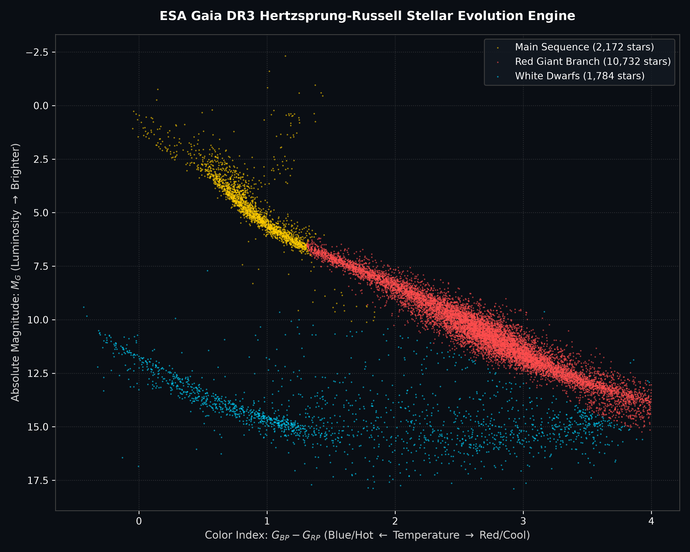

# Gaia DR3 Hertzsprung–Russell Stellar Evolution Engine

An astrophysical data engineering pipeline and unsupervised machine learning classification model utilizing the European Space Agency (ESA) Gaia Data Release 3 (DR3) catalog. The engine queries high-precision astrometric and photometric telemetry via Astronomical Data Access Protocol (TAP/ADQL), derives intrinsic stellar physical properties via distance modulus formulations, and segments stellar evolutionary branches.

---

## Astrophysical & Mathematical Principles

### 1. Trigonometric Parallax to Physical Distance
Trigonometric parallax ($\varpi$) measured by Gaia in milliarcseconds ($\text{mas}$) represents the apparent angular displacement of a star viewed from opposite sides of Earth's orbit. The true geometric distance $d$ in parsecs ($\text{pc}$) is given by:

$$d = \frac{1000}{\varpi}$$

To ensure astrometric fidelity, stars are filtered to include only those with high parallax signal-to-noise ratios ($\varpi / \sigma_\varpi > 10$), mitigating Lutz–Kelker distance bias.

### 2. Distance Modulus & Absolute Bolometric Magnitude
Apparent magnitude ($G$) represents flux measured at Earth, which depends on distance. The absolute magnitude ($M_G$), defining intrinsic luminosity normalized to an isotropic distance of $10\text{ pc}$, is derived via:

$$m - M = 5 \log_{10}(d) - 5$$

Substituting $d = 1000 / \varpi$:

$$M_G = G + 5 + 5 \log_{10}\left(\frac{\varpi}{1000}\right)$$

### 3. Effective Temperature & Color Index
The color index $(G_{BP} - G_{RP})$ serves as an empirical proxy for stellar surface temperature ($T_{\text{eff}}$), defined by the difference in integrated flux between the Blue Photometer ($330\text{--}680\text{ nm}$) and Red Photometer ($640\text{--}1050\text{ nm}$).

---

## Empirical Hertzsprung–Russell Diagram



---

## Machine Learning Architecture

The pipeline implements an unsupervised **Gaussian Mixture Model (GMM)** over the 2D astrometric phase space $\mathbf{x} = [G_{BP} - G_{RP}, M_G]$:

$$p(\mathbf{x}) = \sum_{k=1}^{K} \pi_k \mathcal{N}(\mathbf{x} \mid \boldsymbol{\mu}_k, \boldsymbol{\Sigma}_k)$$

This decomposes the empirical distribution into distinct physical stellar populations:
* **Main Sequence:** Core hydrogen-burning dwarfs spanning the diagonal evolutionary sequence.
* **Red Giant Branch:** High-luminosity, low-temperature post-main-sequence giant stars.
* **White Dwarfs:** Degenerate electron-supported stellar remnants exhibiting low intrinsic luminosity despite high effective surface temperatures.

---

## Setup & Execution

### 1. Clone the Repository
```bash
git clone [https://github.com/agnelavas/gaia-hr-engine.git](https://github.com/agnelavas/gaia-hr-engine.git)
cd gaia-hr-engine